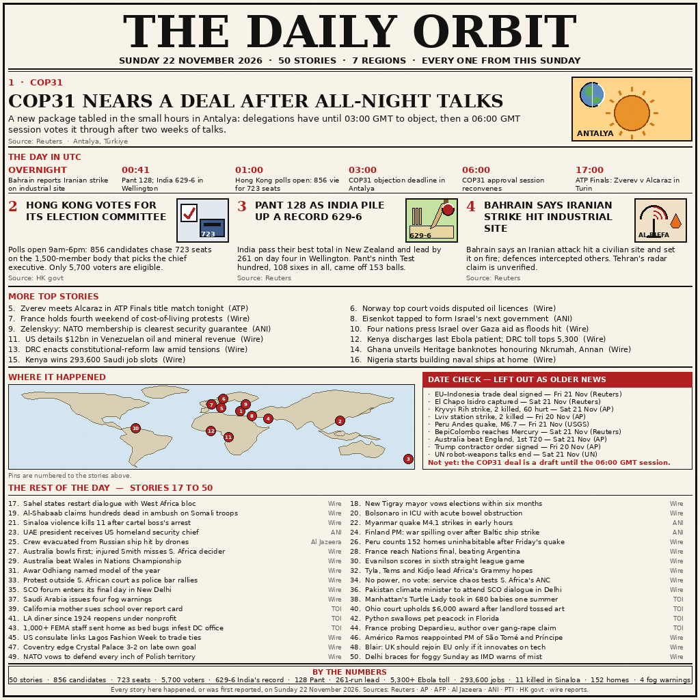

# The Daily Orbit — Sunday 22 November 2026

[](https://make.fun/c/news-image-20261122)
[](https://make.fun/c/news-image-20261122)
[](https://make.fun/c/news-image-20261122)

One image that sums up Sunday 22 November 2026 in world news: **50 sourced
stories from 7 regions**, a UTC timeline of the day, a world map with numbered
pins, and a DATE CHECK box that names the big stories deliberately left out
because they happened on 20 or 21 November.



## The image

* **Masthead** — THE DAILY ORBIT, Sunday 22 November 2026, 50 stories,
  7 regions, every one from this Sunday.
* **Lead** — COP31 nears a deal after all-night talks in Antalya: a new
  package, objections by 03:00 GMT, an approval session at 06:00 GMT.
* **The day in UTC** — six timed beats: the Bahrain strike report overnight,
  Pant's 128 (00:41), Hong Kong polls opening (01:00), the COP31 objection
  deadline (03:00), the COP31 approval session (06:00), and the ATP Finals
  title match in Turin (17:00).
* **Illustrated stories** — Hong Kong votes for its Election Committee
  (856 candidates, 723 seats), Pant 128 as India pile up a record 629-6 in
  Wellington, Bahrain says an Iranian strike hit an industrial site.
* **More top stories (5–16)** — Zverev v Alcaraz, Norway voiding disputed
  oil licences, France's fourth weekend of cost-of-living protests, Eisenkot
  tapped to form Israel's next government, Zelenskyy on NATO, four nations
  pressing Israel over Gaza aid, US details on $12bn of Venezuelan oil and
  mineral revenue, Ebola in Kenya/DRC, DRC constitutional reform, Ghana's
  Heritage banknotes, Kenya's 293,600 Saudi job slots, Nigeria building naval
  ships at home.
* **Where it happened** — a world map with 12 numbered pins, one per lead
  and top story.
* **Date check** — 9 stories explicitly excluded as older news (EU–Indonesia
  deal, El Chapo Isidro's capture, the Kryvyi Rih and Lviv strikes, the Peru
  Andes quake, BepiColombo at Mercury, Australia's T20 win, the Trump
  contractor order, the UN robot-weapons talks), plus a note that the COP31
  deal is still a draft until the 06:00 GMT session.
* **Stories 17–50** — the rest of the day, two columns, one line each.
* **By the numbers** — 50 stories, 856 candidates, 723 seats, 5,700 voters,
  629-6, 128, a 261-run lead, 5,300+ Ebola toll, 293,600 jobs, 11 killed in
  Sinaloa, 152 homes, 4 fog warnings.

## How it runs

The entry image is `entry.png`, rendered by `gen.py` (Pillow, deterministic
— same bytes on every run). `main.py` copies it to the output directory:

```sh
mkdir -p out && MAKEFUN_OUTPUT_DIR=out python3 main.py
# rebuild the image:
python3 gen.py
```

## Sources and date check

Every story was checked for its date: it happened, or was first reported,
on Sunday 22 November 2026 in some timezone. Sources: Reuters, AP, AFP,
Al Jazeera, ANI, PTI, the Hong Kong government, and wire reports. Stories
from 20–21 November are not headlined here; they are listed in the DATE
CHECK box instead, so the page does not pass off yesterday's news as
today's.

## Licence

MIT — see [LICENSE](LICENSE).
